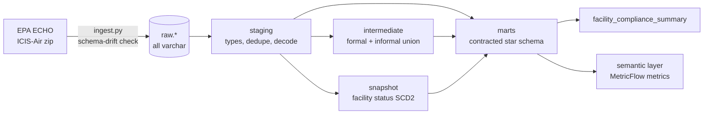

# EPA Clean Air Act Compliance Warehouse 

A dbt + DuckDB warehouse over EPA's public **ICIS-Air** data: every Clean Air Act facility in the United States, its compliance evaluations, violations, and enforcement actions. It is modeled into a tested star schema with type 2 history, contracted marts, and CI on every pull request.

| | |
|---|---|
| **Source** | [EPA ECHO bulk downloads](https://echo.epa.gov/tools/data-downloads), ICIS-Air export, refreshed weekly |
| **Scale** | 280K facilities · 1.8M evaluations · 103K violations · 283K enforcement actions |
| **Stack** | dbt-core 1.12 · DuckDB · MetricFlow · dbt_utils · sqlfluff · GitHub Actions · uv |
| **Tests** | 92 checks per build: generic, singular, reconciliation, and unit tests |

## Why this dataset

ICIS-Air is a real regulatory system of record, and it is messy in the ways production data is messy. Most of the modeling work here is deciding what the data means before counting anything:

| Problem in the source | How it is handled | Where |
|---|---|---|
| One evaluation repeated once per stated purpose (633 extra rows) | Collapsed to one row per evaluation; purposes kept as a list | `stg_icis_air__evaluations` |
| Formal actions repeated with **conflicting penalty amounts** (425 actions) | One row per action; largest penalty kept and flagged with `has_conflicting_penalty_records`, never summed | `stg_icis_air__formal_actions` |
| 163,503 exact duplicate rows in informal actions | Removed | `stg_icis_air__informal_actions` |
| Two date formats (`MM-DD-YYYY` and `MM/DD/YYYY`) depending on the file | One macro parses both | `macros/parse_epa_date.sql` |
| Impossible dates (years 0001, 0218, 8888): 169 values | Nulled in staging and counted by a warning test, so nothing disappears silently | `warn_implausible_source_dates` |
| Violations "resolved before they started" (3,291) | The start field is a *determination* date, so these are violations corrected before the paperwork was entered. They are excluded from durations instead of producing negative days | `fct_violations`, `warn_resolved_before_identified` |

**The penalty duplicates matter.** A naive `sum(penalty_amount)` over the raw export gives **$5.848B**. The deduplicated total is **$5.794B**, so the naive sum overstates penalties by **$54.1M**. `assert_penalties_not_double_counted` fails the build if the fact table ever drifts from the per-action source total.

## Architecture



**Extract and load** (`ingest/ingest.py`) downloads the export, compares each file's header to `ingest/expected_schemas.json`, and stops with the added and removed column names if EPA changed a layout. It then loads all-varchar tables into `raw` with `_loaded_at` and `_source_file` audit columns. Every type decision happens in dbt.

**Staging** (`models/staging/icis_air/`) renames columns, parses dates, decodes agency flags, and resolves each table's duplicate pattern. Views.

**Marts** (`models/marts/`) form a star schema. Every mart has an enforced **model contract**, so a column or type change fails the build instead of reaching consumers.

| Model | Grain | Notes |
|---|---|---|
| `dim_facility` | facility | Current state (type 1) |
| `dim_facility_status_history` | facility × status period | Type 2, from `snap_facility_compliance_status` |
| `dim_air_program` | Clean Air Act program | SIP, NSPS, NESHAP, MACT, Title V… |
| `bridge_facility_air_program` | facility × program | Many-to-many enrollment |
| `dim_date` | day | Calendar plus **federal fiscal year** (Oct–Sep), the year EPA reports in |
| `fct_compliance_evaluations` | evaluation | **Incremental** `merge` with a 90-day lookback, because EPA backfills late evaluations |
| `fct_violations` | violation | HPV and FRV, with resolution durations |
| `fct_enforcement_actions` | action | Formal and informal, with penalties |
| `facility_compliance_summary` | facility | Inspection coverage, open HPVs, penalties |

**Snapshot.** EPA publishes only each facility's *current* status. `snap_facility_compliance_status` (check strategy on operating status, HPV status, and pollutant class) keeps the history between weekly loads.

**Semantic layer.** `models/semantic/_semantic_models.yml` defines MetricFlow semantic models on the four core marts, joined through a shared `facility` entity, and nine metrics defined once:

| Metric | Type | Definition |
|---|---|---|
| `total_penalties` | simple | Deduplicated assessed penalties (never sums conflicting source records) |
| `enforcement_action_count` / `formal_action_count` | simple, filtered | All actions / orders and judicial cases only |
| `violation_count` / `hpv_count` | simple, filtered | All violations / high priority violations |
| `median_days_to_resolution` | simple (median) | Identification to resolution; negative durations excluded upstream |
| `evaluation_count` / `on_site_evaluation_count` | simple | Compliance evaluations |
| `on_site_evaluation_rate` | ratio | On-site share of evaluations |

Any metric can be sliced by time grain or by facility attributes (state, EPA region, pollutant class) without redefining it:

```bash
uv run mf query --metrics hpv_count,median_days_to_resolution --group-by facility__epa_region
```

## Testing

Each `dbt build` runs:

- **Generic tests:** primary keys, foreign keys from every fact to `dim_facility` and `dim_date`, accepted values for decoded codes, and non-negative ranges.
- **Unit tests:** fixed inputs for the tricky logic: both date formats, implausible years, purpose collapsing, and the max-not-sum penalty rule.
- **Reconciliation tests:** every source action appears exactly once in the fact table, and penalty totals match the source.
- **Warning tests:** known source-quality issues stay visible on every run without blocking it.
- **Source freshness:** warn after 8 days and error after 15, since EPA refreshes weekly.

## CI

`.github/workflows/ci.yml` runs on every pull request and every push to `main`:

1. `sqlfluff lint` with the dbt templater
2. Load the committed Tennessee sample (`data/sample/`, 4,096 facilities, under 1 MB), including the schema-drift check
3. `dbt source freshness`
4. `dbt build`: models, snapshot, and all tests
5. A second incremental run, to exercise the `merge` path and not only the first build
6. `mf validate-configs` checks every semantic model, dimension, measure, and metric against the built warehouse, then a metric is queried end to end

`.github/workflows/docs.yml` publishes the dbt docs site, with the lineage graph, to GitHub Pages on every push to `main`.

CI runs on the sample so that it is fast (about 15 seconds of dbt) and never depends on EPA's servers. The full national dataset builds locally in under a minute.

## Running it

Requires [uv](https://docs.astral.sh/uv/). It installs Python 3.12 and every dependency.

```bash
make setup     # Python deps + dbt packages
make ingest    # download the ICIS-Air export (~70 MB) and load data/warehouse/epa.duckdb
make build     # freshness, models, snapshot, tests
make docs      # browse models and lineage at localhost:8080
make metrics   # validate the semantic layer and query metrics
```

To reproduce CI locally on the sample:

```bash
make ci
```

Run `make ingest` and then `dbt snapshot` (or `make build`) weekly to accumulate facility status history.

## Project layout

```
ingest/              extract + load, schema-drift check, sample builder
data/sample/         Tennessee slice used by CI (committed)
models/staging/      one model per source table
models/intermediate/ formal + informal enforcement union
models/marts/core/   contracted star schema
models/marts/compliance/  facility-level summary
models/semantic/     MetricFlow semantic models, metrics, time spine
snapshots/           facility status SCD2
tests/singular/      reconciliation and data-quality warnings
macros/              date parsing, agency decoding, schema naming
```

## Roadmap

- Clean Water Act (ICIS-NPDES) and RCRA hazardous waste, sharing `dim_facility` through the FRS registry ID
- An agent that answers compliance questions through the semantic layer, evaluated against a set of questions with known answers

## Notes

- ICIS-Air is public data published by the U.S. EPA. This project is independent and not affiliated with EPA.
- Deletions in EPA's export are not propagated to the incremental fact table; a periodic `dbt build --full-refresh` reconciles them.
